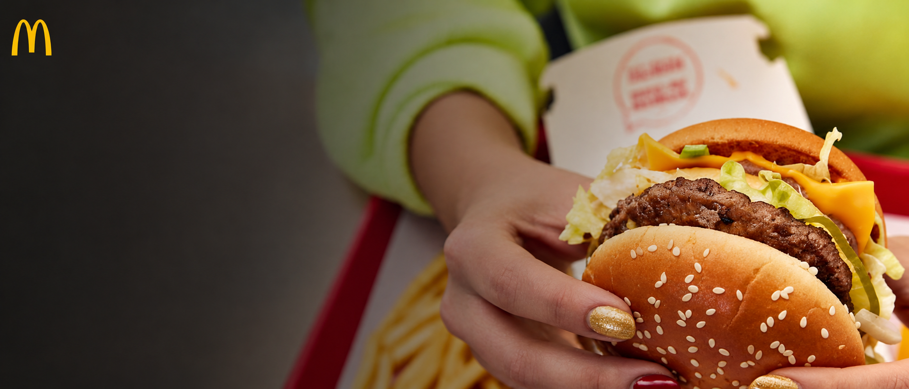

<h1 align="center">🍔 Cardápio Interativo (Burger)</h1>

  

  <b><a href="https://jonataswebj-lab.github.io/Burgers/">🔗 Ver site no ar</a></b>

Cardápio online de uma lanchonete fictícia: o usuário filtra os produtos por categoria, seleciona os itens que quer, vê o total da compra e escolhe a forma de pagamento, com desconto no Pix.

## O que o projeto faz
- Filtros por categoria: lanches, veganos, bebidas e sobremesas
- Clique no item para selecionar ou desmarcar (a seleção se mantém ao trocar de filtro)
- Botão com os preços já com **10% de desconto no Pix**
- Resumo da compra com lista dos itens, total e escolha da forma de pagamento
- Navegação por teclado (Enter e Espaço) nos itens

## Tecnologias

## O que pratiquei
- Métodos de array: `map`, `filter`, `reduce` e `forEach`
- Manipulação do DOM e eventos (incluindo delegação de eventos)
- `Set` para guardar os itens selecionados
- Formatação de moeda com `toLocaleString`
- Layout responsivo com CSS Grid, Flexbox e `@media`

## Estrutura
- `products.js`: lista de produtos (dados)
- `script.js`: filtros, seleção e cálculo da compra
- `index.html` e `style.css`: estrutura e visual

## Sobre o desenvolvimento
Parte da lógica (seleção de itens, resumo da compra e acessibilidade) foi feita com apoio de IA, e eu revisei e estudei o código.

## Próximos passos
- [ ] Mostrar a lista de produtos assim que a página abrir
- [ ] Adicionar quantidade de cada item
- [ ] Guardar o carrinho no `localStorage`
- [ ] Dar um `id` a cada produto

## Como rodar
Baixe o repositório e abra o `index.html` no navegador.
